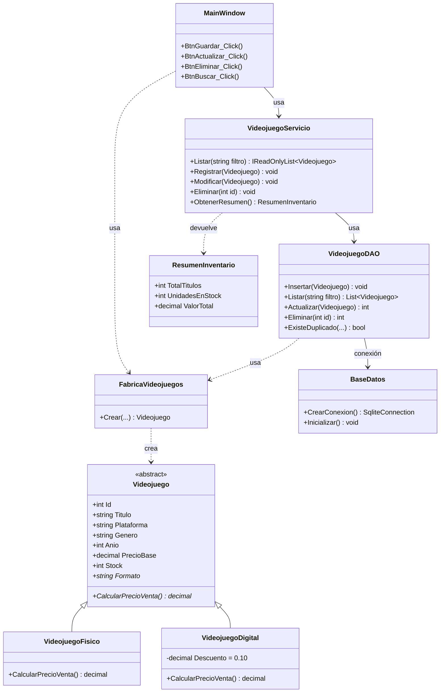

# Inventario de Videojuegos - Aplicación de escritorio en C# (Avalonia + ADO.NET + SQLite)

Parcial final de **Programación con C# y .NET**. Aplicación de escritorio para administrar el inventario de una tienda de videojuegos: registrar, consultar, modificar y eliminar títulos, con los datos guardados en una base de datos SQLite.

## 1. Información general

- **Nombre del proyecto:** Inventario de Videojuegos
- **Estudiante:** Jhon Mateo Guette Vera
- **Asignatura:** Programación con C# y .NET (parcial final)
- **Descripción:** la aplicación permite llevar el control de los videojuegos de una tienda (título, plataforma, género, formato, año, precio y stock) desde una interfaz gráfica, sin usar la terminal.
- **Problema que resuelve:** llevar el inventario en papel o en una hoja de Excel es desordenado y permite errores (títulos repetidos, precios o stocks inválidos). La aplicación centraliza la información, valida los datos antes de guardarlos y calcula el valor del inventario.
- **Objetivo principal:** aplicar Programación Orientada a Objetos, Avalonia UI y ADO.NET con SQLite en una aplicación sencilla pero completa, con CRUD y persistencia de datos.

## 2. Funcionalidades

- **Registrar** un videojuego nuevo (botón *Guardar nuevo*).
- **Consultar** todos los videojuegos en una tabla y **buscar** por título, plataforma, género o formato.
- **Modificar** un videojuego: se selecciona en la tabla, se editan los datos en el formulario y se presiona *Actualizar*.
- **Eliminar** un videojuego seleccionado, con una ventana que pide confirmación.
- **Resumen del inventario** siempre visible: cantidad de títulos, unidades en stock y valor total del inventario.
- **Precio de venta según el formato** (polimorfismo): Físico = precio base; Digital = precio base con 10 % de descuento.
- **Validaciones** con mensajes claros: título vacío, año fuera de rango, precio o stock inválidos, campos sin seleccionar y videojuegos repetidos (mismo título, plataforma y formato).
- **Mensajes** de éxito (verde) y de error (rojo) en la parte inferior de la ventana. Los errores nunca cierran el programa.
- Los datos se conservan al cerrar y volver a abrir la aplicación.

## 3. Tecnologías utilizadas

| Tecnología | Detalle |
| --- | --- |
| Lenguaje | C# |
| Plataforma | .NET 8.0 |
| Interfaz gráfica | Avalonia UI 11.2.3 (archivos `.axaml`) |
| Acceso a datos | ADO.NET con `Microsoft.Data.Sqlite` 8.0.10 |
| Base de datos | SQLite |
| Paquetes adicionales | `Avalonia.Desktop`, `Avalonia.Themes.Fluent` y `Avalonia.Controls.DataGrid` (versión 11.2.3) |

## 4. Estructura del proyecto

```text
InventarioVideojuegos/
├── Program.cs                 # Punto de entrada (abre la ventana o ejecuta las pruebas)
├── App.axaml / App.axaml.cs   # Configuración de Avalonia
├── InventarioVideojuegos.csproj
├── Modelos/
│   ├── Videojuego.cs          # Clase abstracta
│   ├── VideojuegoFisico.cs
│   ├── VideojuegoDigital.cs
│   └── FabricaVideojuegos.cs  # Crea el tipo correcto según el formato
├── Datos/
│   ├── BaseDatos.cs           # Conexión y creación de la tabla
│   ├── VideojuegoDAO.cs       # Todo el SQL (CRUD con ADO.NET)
│   └── script.sql             # Script de la tabla (referencia)
├── Servicios/
│   ├── VideojuegoServicio.cs  # Lógica del programa
│   └── ResumenInventario.cs
├── Excepciones/
│   └── InventarioExcepciones.cs
├── Vistas/
│   ├── MainWindow.axaml / .axaml.cs
│   └── ConfirmacionWindow.axaml / .axaml.cs
├── Pruebas/
│   └── CasosDePrueba.cs       # Pruebas que se ejecutan con --pruebas
├── Utilidades/
│   └── FormatoMoneda.cs
├── evidencias/                # Capturas de las pruebas
├── README.md
└── .gitignore
```

### Clases y cómo se relacionan

| Clase | Responsabilidad |
| --- | --- |
| `Videojuego` (abstracta) | Datos comunes (id, título, plataforma, género, año, precio base, stock) y validación en el constructor. Declara `CalcularPrecioVenta()` como abstracto. |
| `VideojuegoFisico`, `VideojuegoDigital` | Heredan de `Videojuego` e implementan su propia regla de precio. |
| `FabricaVideojuegos` | Crea el objeto del tipo correcto a partir del texto del formato. |
| `BaseDatos` | Crea las conexiones con SQLite y la tabla `videojuegos` si no existe. |
| `VideojuegoDAO` | Ejecuta las sentencias SQL (insertar, listar, actualizar, eliminar). Es la única clase que escribe SQL. |
| `VideojuegoServicio` | Reglas del programa: evita duplicados, verifica que el registro exista y calcula el resumen. |
| `ResumenInventario` | Guarda los totales del inventario (títulos, unidades y valor). |
| `MainWindow` | Ventana principal: lee el formulario, responde a los eventos y muestra los datos. No contiene reglas de negocio. |
| `ConfirmacionWindow` | Ventana que pide confirmar antes de eliminar. |
| `InventarioException` y derivadas | Errores propios con mensajes claros. |

Flujo de una operación:

`MainWindow` → `VideojuegoServicio` → `VideojuegoDAO` → `BaseDatos` → SQLite

`Videojuego` es el objeto que viaja entre las capas.

### Diagrama UML de clases



### Dónde se aplica cada concepto de POO

- **Encapsulamiento:** las propiedades de `Videojuego` son de solo lectura (`{ get; }`) y solo se asignan en el constructor, después de validarlas. `VideojuegoServicio` devuelve `IReadOnlyList<Videojuego>`. El SQL está encerrado en `VideojuegoDAO` y la ventana no lo conoce.
- **Abstracción:** `Videojuego` es `abstract`: no se puede crear un "videojuego genérico", solo uno físico o digital. Obliga a cada tipo a implementar `Formato` y `CalcularPrecioVenta()`.
- **Herencia:** `VideojuegoFisico` y `VideojuegoDigital` heredan de `Videojuego` y reutilizan sus propiedades y validaciones.
- **Polimorfismo:** la tabla, el resumen y el servicio trabajan con el tipo `Videojuego`; al pedir `PrecioVenta`, cada objeto responde con su propia regla (físico = base, digital = -10 %).
- **Constructores y métodos:** el constructor de `Videojuego` valida los datos y lanza `ValidacionException` si son inválidos; cada clase tiene métodos con una sola tarea (`Insertar`, `Listar`, `Registrar`, `ObtenerResumen`...).
- **Separación de responsabilidades:** interfaz (`Vistas`), lógica (`Servicios`) y acceso a datos (`Datos`).
- **Excepciones propias:** `ValidacionException`, `VideojuegoDuplicadoException`, `VideojuegoNoEncontradoException` y `BaseDatosException`, todas derivadas de `InventarioException`. La ventana las captura y muestra el mensaje sin cerrarse.

## 5. Instalación de dependencias

1. Instalar el **SDK de .NET 8.0** (o superior): <https://dotnet.microsoft.com/download>. Para comprobarlo:
   ```bash
   dotnet --version
   ```
   El proyecto apunta a `net8.0`. Si tu SDK es otro, cambia `TargetFramework` en `InventarioVideojuegos.csproj` por tu versión.
2. Instalar **Git**: <https://git-scm.com/downloads>.
3. Obtener el código desde GitHub:
   ```bash
   git clone https://github.com/mateoguettevera0724-jpg/InventarioVideojuegos-CSharp.git
   cd InventarioVideojuegos-CSharp
   ```
4. Restaurar las dependencias (descarga Avalonia y Microsoft.Data.Sqlite desde NuGet; se necesita internet la primera vez):
   ```bash
   dotnet restore
   ```

Paquetes que se restauran: `Avalonia`, `Avalonia.Desktop`, `Avalonia.Themes.Fluent`, `Avalonia.Controls.DataGrid` y `Microsoft.Data.Sqlite`. No hace falta instalar SQLite por separado ni hacer ninguna otra configuración.

## 6. Ejecución del programa

Desde la carpeta donde está el archivo `InventarioVideojuegos.csproj`:

```bash
dotnet restore
dotnet run
```

Se abre la ventana de la aplicación.

Para ejecutar solo los casos de prueba automáticos (sin abrir la ventana):

```bash
dotnet run -- --pruebas
```

## 7. Base de datos

- **Qué información almacena:** los videojuegos del inventario.
- **Motor y archivo:** SQLite, archivo `inventario.db`.
- **Cómo se crea:** se genera **automáticamente** la primera vez que se ejecuta el programa (`BaseDatos.Inicializar()`, que usa `CREATE TABLE IF NOT EXISTS`). No hay que ejecutar ningún procedimiento previo. El archivo queda junto al ejecutable, en `bin/Debug/net8.0/`. El mismo SQL está en `Datos/script.sql` como referencia.

**Tabla `videojuegos`:**

| Campo | Tipo | Descripción |
| --- | --- | --- |
| id | INTEGER (PK, autoincremental) | Identificador |
| formato | TEXT | Físico o Digital |
| titulo | TEXT | Nombre del videojuego |
| plataforma | TEXT | PC, PlayStation, Xbox o Switch |
| genero | TEXT | Género |
| anio | INTEGER | Año de lanzamiento |
| precio_base | REAL | Precio base |
| stock | INTEGER | Unidades disponibles |

**Conexión con SQLite:** `BaseDatos.CrearConexion()` devuelve un `SqliteConnection` con la cadena `Data Source=<ruta>/inventario.db`. Cada método del DAO abre su conexión dentro de un `using`, por lo que se cierra sola al terminar, aunque ocurra un error.

**Operaciones CRUD** (todas en `Datos/VideojuegoDAO.cs`, siempre con parámetros `$nombre` para evitar inyección SQL):

| Operación | Método | Sentencia |
| --- | --- | --- |
| Create | `Insertar` | `INSERT INTO` |
| Read | `Listar` | `SELECT ... WHERE ... LIKE` |
| Update | `Actualizar` | `UPDATE ... WHERE id` |
| Delete | `Eliminar` | `DELETE ... WHERE id` |

## 8. Pruebas y evidencias de funcionamiento

Los seis escenarios se pueden probar desde la ventana. Además, `dotnet run -- --pruebas` ejecuta automáticamente los casos contra un archivo de base de datos temporal (no toca los datos reales).

| # | Prueba | Acción | Resultado esperado |
| --- | --- | --- | --- |
| 1 | Registro | Agregar un videojuego | El registro se guarda en la base de datos |
| 2 | Consulta | Visualizar y buscar | Se muestran los registros almacenados |
| 3 | Actualización | Modificar un videojuego | Los cambios se guardan correctamente |
| 4 | Eliminación | Eliminar un videojuego | El registro deja de aparecer |
| 5 | Validación | Introducir información incorrecta | El programa informa el error sin cerrarse |
| 6 | Persistencia | Cerrar y abrir el programa | Los registros siguen disponibles |

### Prueba 1: Registro
Se llenó el formulario con un videojuego nuevo y se presionó *Guardar nuevo*. El registro apareció en la tabla y se mostró el mensaje de éxito.


### Prueba 2: Consulta
Se visualizaron los videojuegos almacenados y se probó el buscador por título, plataforma, género o formato.


### Prueba 3: Actualización
Se seleccionó un videojuego en la tabla, se cambió su precio y stock y se presionó *Actualizar*. La tabla y el resumen mostraron los datos nuevos.


### Prueba 4: Eliminación
Se seleccionó un videojuego, se presionó *Eliminar* y se confirmó en la ventana emergente. El registro dejó de aparecer en la tabla.


### Prueba 5: Validación
Se intentó guardar con el título vacío y con letras en el campo de precio. El programa mostró el mensaje de error en rojo y no se cerró.


### Prueba 6: Persistencia
Se cerró la aplicación y se volvió a abrir con `dotnet run`. Los registros guardados seguían disponibles.


### Pruebas automáticas (complementaria)
Salida de `dotnet run -- --pruebas`.


## 9. Problemas encontrados y soluciones

**Problema 1: el precio se guardaba como texto en SQLite.**
Al enviar un `decimal` como parámetro, `Microsoft.Data.Sqlite` lo guarda como `TEXT` y al leerlo la conversión no era directa. **Solución:** el precio se envía como `double` al guardarlo (columna `REAL`) y al leerlo se usa `GetDouble` convertido a `decimal` en el DAO.

**Problema 2: la tabla (DataGrid) no se veía al ejecutar.**
El control `DataGrid` está en un paquete aparte y necesita su propio estilo. **Solución:** instalar el paquete `Avalonia.Controls.DataGrid` y agregar el `StyleInclude` de su tema en `App.axaml`.

**Problema 3: no se veía la salida de las pruebas en consola.**
Con el tipo de salida `WinExe` una aplicación gráfica no muestra texto en la terminal. **Solución:** usar `OutputType` `Exe` en el `.csproj`, de modo que `dotnet run -- --pruebas` imprima los resultados.

## Preguntas de sustentación

**¿Por qué utilizaste una clase abstracta `Videojuego` en lugar de crear clases independientes para el formato físico y el digital?**

Porque los dos formatos comparten casi todo: título, plataforma, género, año, precio base, stock y las validaciones del constructor. Lo único que cambia es **cómo se calcula el precio de venta**. Si hubiera hecho dos clases independientes, habría repetido las propiedades y las validaciones en cada una, y cualquier corrección habría que hacerla dos veces. Con `Videojuego` ese código vive en un solo lugar y las clases hijas solo escriben lo propio:

```csharp
public class VideojuegoDigital : Videojuego
{
    public override decimal CalcularPrecioVenta() => PrecioBase * (1 - Descuento);
}
```

Además, como `CalcularPrecioVenta()` es abstracto, el compilador obliga a cada formato nuevo a definir su regla de precio. Y por el polimorfismo, la tabla, el servicio y el resumen trabajan con el tipo `Videojuego` sin saber si es físico o digital. Si mañana se necesitara un formato nuevo (por ejemplo, edición coleccionista), bastaría con crear una clase nueva y agregarla en `FabricaVideojuegos`, sin tocar la ventana ni el DAO.

**¿Cómo se conecta la interfaz con la lógica y con ADO.NET?**

Cuando el usuario presiona *Guardar nuevo*, el evento `BtnGuardar_Click` de `MainWindow` lee los controles del formulario y crea el objeto con `FabricaVideojuegos.Crear`, cuyo constructor valida los datos (si algo está mal lanza `ValidacionException`). Luego llama a `VideojuegoServicio.Registrar`, que verifica que no esté repetido y llama a `VideojuegoDAO.Insertar`. El DAO abre un `SqliteConnection`, crea un `SqliteCommand` con la sentencia `INSERT` y parámetros, y lo ejecuta con `ExecuteNonQuery`. Al terminar, la ventana recarga la tabla con `Listar` y muestra el mensaje de éxito; si ocurre cualquier error, lo captura y muestra el mensaje en rojo sin cerrarse. La ventana nunca escribe SQL y el DAO nunca conoce la ventana.

## Autor

Jhon Mateo Guette Vera
